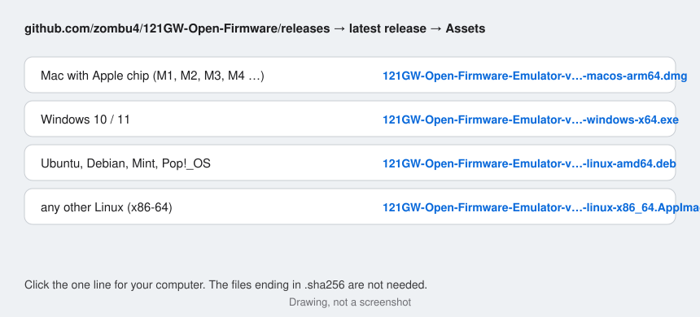
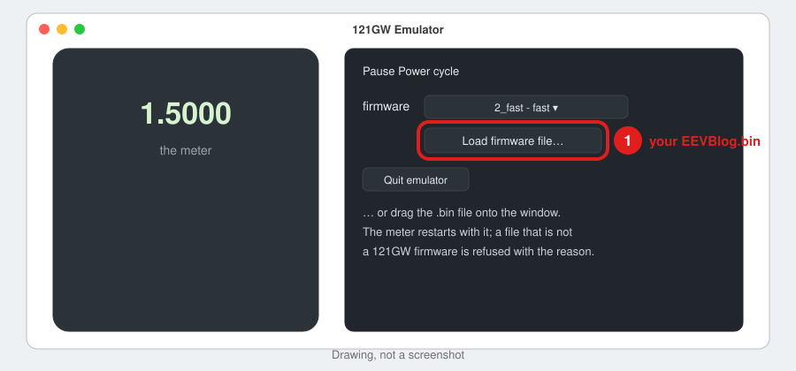

# Start the 121GW emulator — step by step

The emulator is a 121GW multimeter on your computer. Everything it needs is inside the download: you do **not** install
Python or anything else. The pictures below are drawings of what your computer shows; the thing to click is ringed in
red.

**Why is there a warning the first time?** The app is free and not paid-signed by Apple or Microsoft, so the computer
asks once whether you trust it. You confirm once; after that it starts like any other program.

## 1. Download the right file

Open [the latest release](https://github.com/zombu4/121GW-Open-Firmware/releases/latest) and click the one file for your computer under **Assets**:

The Mac version needs a Mac with an Apple chip (M1 or later; Apple menu → **About This Mac** shows "Chip Apple …").
There is no version for Macs with an Intel processor.

## 2a. Mac

1. Double-click the downloaded `.dmg` file. A window opens: drag **121GW Emulator** onto **Applications**.

   

2. Open **Applications** and double-click **121GW Emulator**. The first time macOS says it could not verify the app:
   click **Done** (not "Move to Trash").

   

3. Apple menu → **System Settings** → **Privacy & Security**. Scroll down to **Security** and click **Open Anyway**.

   

4. Click **Open Anyway** once more and type your Mac password (or use Touch ID).

   

The emulator window opens. From now on a double-click on **121GW Emulator** is enough.

## 2b. Windows 10 / 11

1. If your browser says the file "isn't commonly downloaded": click **•••** → **Keep** → **Show more** →
   **Keep anyway**.

   

2. Double-click the downloaded `.exe`. Windows shows a blue box: click **More info** …

   

   … then **Run anyway**.

   

3. The installer: tick **I accept the agreement**, **Next**, leave **Create a desktop icon** ticked, **Next**,
   **Install**, **Finish**. No administrator password is needed.

   

The emulator window opens. Next time: double-click **121GW Emulator** on the desktop or in the Start menu.

## 2c. Linux

**Ubuntu, Debian, Linux Mint, Pop!\_OS:** take the `.deb` file. In the Files app right-click it → **Open With App
Center** (or double-click it), click **Install** and type your password. Then **Show Apps** → **121GW Emulator**.

Or in a terminal, in the folder of the file: `sudo apt install ./121GW-Open-Firmware-Emulator-*-linux-amd64.deb`

**Any other Linux (64-bit PC):** take the `.AppImage`. Right-click it → **Properties** → switch on **Executable as
Program** (older systems: tab **Permissions**, tick **Allow executing file as program**), close, double-click the file.

On Linux the emulator opens in your web browser; stop it with the **Quit emulator** button on the page.

## 3. Use it

- Click the keys and turn the dial on the drawn meter; set what is connected to the probes under **Input stimulus**.
- **Firmware:** the two builds of this project are downloaded from GitHub the first time you choose them in the
  **firmware** list (fast at the first start), then kept on the computer, so this needs the internet once. To try your own
  `EEVBlog.bin` click **Load firmware file…** or drag the file onto the window. The meter restarts with it; a file
  that is not a 121GW firmware is refused and the reason is shown.

  

- **Stop:** close the window (Mac, Windows) or click **Quit emulator**.

The emulated meter starts with made-up calibration and no serial number. Never copy a `cal.bin` that the emulator
writes to a real meter.

## Problems

- **Windows: no window, the browser opens instead** — the computer lacks Microsoft Edge WebView2. It still works in
  the browser; for the window install "WebView2 Runtime" from microsoft.com (free).
- **Something else:** open an issue on GitHub with your system (for example "Windows 11", "macOS 15",
  "Ubuntu 24.04") and what you saw.
